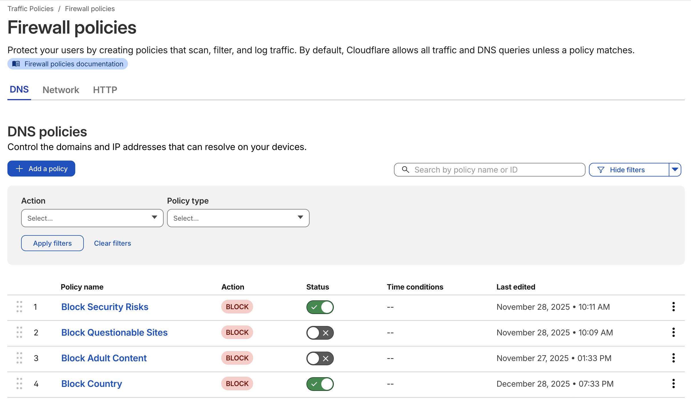
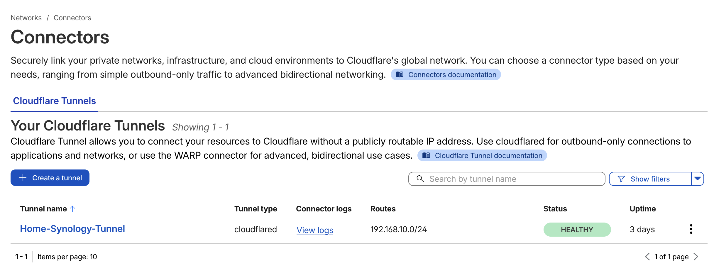
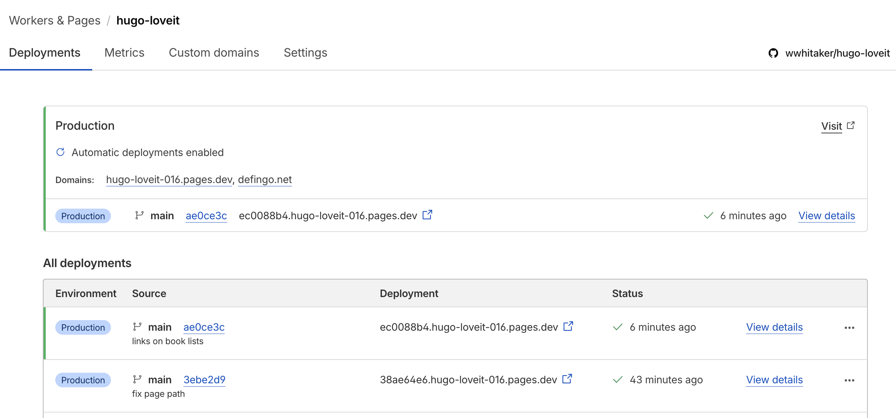

+++
title = 'Cloudflare Overview'
description = 'The four jobs Cloudflare does for my homelab, all on the free tier'
date = '2026-03-20'
lastmod = '2026-10-15'
draft = false
tags = ['homelab', 'networking', 'cloudflare', 'dns']
categories = ['Homelab']
+++

Cloudflare has quietly become one of the most important pieces of my homelab, and almost none of it costs anything. It handles four jobs for me today, and I keep finding more in its product list.

| Job | Product | What it does for me | Cost |
| --- | --- | --- | --- |
| Domains and public DNS | Registrar, DNS | Owns `defingo.net` and answers for it | Domain renewals only |
| DNS filtering | Zero Trust Gateway | Filters every lookup my home network makes | Free |
| Remote access | Tunnel + Access | Publishes a few apps without opening ports | Free |
| This website | Pages | Builds and hosts this Hugo site | Free |

## Domains and DNS

My domain is registered with Cloudflare, and its public DNS is hosted there too. Cloudflare's registrar charges what the registry charges, with no markup, so renewals are cheaper than most places and there are no upsells along the way.

Only public records live in Cloudflare. Everything inside the house uses `lan.defingo.net`, which my home gateway answers locally. I wrote about why I split it that way in [Homelab DNS Domain](/posts/homelab-dns-domain/). The short version: a subdomain of a domain you own gives you real certificates and no name collisions, without putting internal names on the Internet.

Having DNS at Cloudflare is also what makes the rest of this work. Tunnels create their own DNS records, and certificate tools can prove domain ownership through Cloudflare's API.

## DNS Filtering with Gateway

Most people know Cloudflare's public 1.1.1.1 resolver. Fewer know that the Zero Trust suite includes **Gateway**, which gives you your own DNS endpoint with your own policies and logs.

The setup at home is simple. My UniFi gateway forwards all internet lookups over **DNS over HTTPS** to a Gateway address unique to my account. Every device on every network gets filtered, with nothing installed on any of them.

My DNS policies are short:

* **Block Security Risks** is on: malware, phishing, command-and-control and similar categories.
* **Block Country** is on, for lookups that resolve into countries I have no reason to reach.
* **Block Questionable Sites** and **Block Adult Content** exist but are off.

Those last two are off because filtering happens in **two layers**. The UniFi gateway applies its own content filter first, with ad blocking, Safe Search for Google, Bing and YouTube, and basic adult filtering. Gateway then handles the security categories and keeps a searchable log of every query. Splitting it this way means family-friendly settings live where I manage the network, and threat filtering lives with a team that updates it constantly.

A few things I learned along the way:

* **Your DoH address identifies your account.** Queries sent to it count against your policies and appear in your logs. Treat it like a password and keep it out of screenshots and notes.
* **Keep a plain fallback.** My gateway also has `1.1.1.1` configured on the WAN, so a problem with DoH doesn't take the house offline.
* **The logs are the hidden benefit.** When something odd happens on the network, Gateway shows which device asked for what, and whether it was blocked.

## Remote Access with Tunnel and Access

A Cloudflare Tunnel lets me publish a handful of apps from home without opening a single port. A small `cloudflared` container on my NAS keeps an outbound connection to Cloudflare, and **Access** decides who gets through before anything reaches the house.

What I like most is that each app gets its own rule:

* **People** sign in with Google, so family can use a browser without another password.
* **Apps** present a service token in their headers, which is how mobile apps reach my monitoring.
* **Everything else** gets a 404 from the tunnel's catch-all rule, so a guessed hostname goes nowhere.

I compared this with Tailscale, including step-by-step setup and service tokens, in [Tailscale or Cloudflare Tunnel for Family Apps](/posts/tailscale-vs-cloudflare-tunnel/). The short version: I use Tailscale for my own access to everything, and a tunnel for anything other people use.

One tip from my own setup: point tunnel routes at **IP addresses**, not internal hostnames. My home DNS has a wildcard record, so a hostname that stops existing silently resolves to my reverse proxy instead of failing loudly.

## Hosting This Site with Pages

My first real use of Cloudflare was its CDN, and that led me to **Pages** for this website. Pages is connected to the site's Git repository. Every push to `main` triggers a Hugo build and deploys it in about a minute, with the custom domain and certificates handled automatically.

A few things make it pleasant for a personal site:

* **Every deployment is kept.** Each one gets its own URL, so rolling back is a click.
* **Preview builds.** A branch gets its own preview address, which is handy for checking a draft before it goes live.
* **Pin the Hugo version** in the build settings. Pages' default Hugo is often older than the theme expects, and a theme that suddenly fails to build is usually that.

## Wrap Up

The thing that still surprises me is that I'm on Cloudflare's free tier for everything here. The only money I spend is on domain renewals, which I'd pay anywhere. If you run a homelab and already own a domain, moving its DNS to Cloudflare is a small step that opens the door to all of this.
