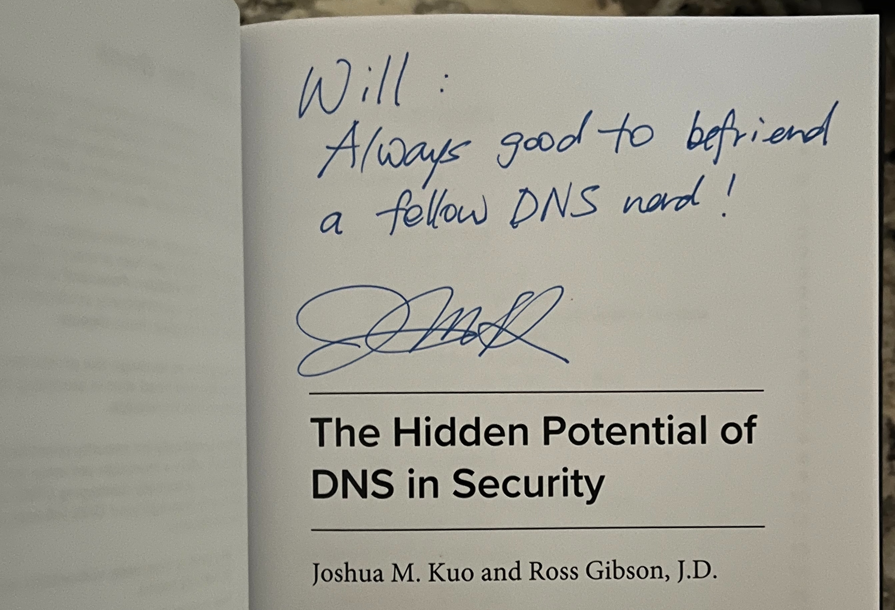

+++
title = 'Infoblox Lunch with Josh Kuo'
description = 'A signed copy of The Hidden Potential of DNS in Security from a fellow DNS nerd'
date = '2024-04-24T11:52:57-04:00'
draft = false
tags = ['dns', 'security', 'books']
categories = ['Career']
featuredImage = 'book-signed-kuo.jpeg'
+++

Back in 2018 I wrote about meeting [Cricket Liu](/posts/cricket-liu/) at a local Infoblox Users Group and getting my copy of DNS and BIND signed. Today Infoblox held a small lunch meetup, and I came home with another signed DNS book from another Infoblox author.

Unlike Cricket, who I only met once, Josh Kuo is someone I've had the pleasure of meeting and talking with on several occasions. He co-wrote *The Hidden Potential of DNS in Security* with Ross Gibson, and he signed my copy.

> Will: Always good to befriend a fellow DNS nerd!

It's a good companion to the older books on my shelf. DNS and BIND taught me how DNS works; this one is about what DNS can tell you about security.

Thanks Josh.
