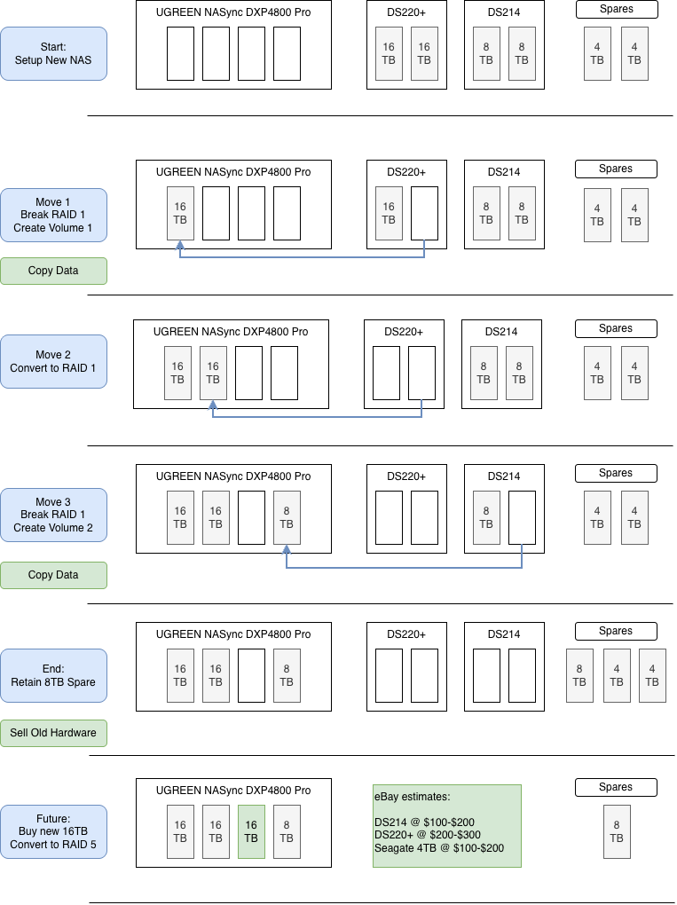

+++
title = 'Moving from Two Synologys to One UGREEN NAS'
description = 'Shuffling drives between three NASes so I never had to buy new ones, and rethinking backups along the way'
date = '2026-03-18T11:52:57-04:00'
draft = false
tags = ['homelab', 'synology', 'ugreen', 'backups']
categories = ['Homelab']
+++

Having a few extra servers sitting around has been the normal for a long time. For years my storage was two Synology NASes: a DS220+ with a pair of 16 TB drives and an older DS214 with a pair of 8 TB drives, each running RAID 1. This year I replaced both with a single UGREEN NASync DXP4800 Pro.

The main reason was consolidation. Two 2-bay NASes meant two boxes drawing power, two sets of resources, and two mirrors that could never be anything more than RAID 1. One 4-bay NAS could pool the power and resources, and leave room to move beyond RAID 1 later.

Staying with Synology had a downside: its policies around which drives its hardware will accept. UGREEN was open about drives, and appeared to have better hardware specs.

The catch was the drives. I didn't want to buy a new set just to move data I already had, so the plan was to move the existing drives over one at a time.

## The Plan

RAID 1 makes this possible. Each drive in a mirror holds a full copy of the data, so you can pull one out, leave the old NAS running degraded on the other, and use the pulled drive to start a new volume.

1. **Set up the UGREEN** with no drives from the old NASes yet.
2. **Move 1:** break the DS220+'s mirror, move one 16 TB drive to the UGREEN as Volume 1, and copy the data across. The data now lives on the old drive and the new volume.
3. **Move 2:** once the copy checks out, move the second 16 TB drive over and convert Volume 1 to RAID 1.
4. **Move 3:** repeat with the DS214: one 8 TB drive becomes Volume 2, then copy the data.
5. **Sell the old hardware.**
6. **Someday:** add a new 16 TB drive and convert Volume 1 to RAID 5.

The risk is in the gap. From breaking a mirror until the copy finishes, the only full copy of that data is on one drive in a degraded NAS, so current backups matter most right then.

## How It Went

The drive moves worked smoothly. Rebuilding each RAID took a while, but the whole migration was done in about a week of total time. The one change I made was to Move 3: instead of keeping the second 8 TB drive as a spare, I moved it over too and converted Volume 2 to RAID 1. Both volumes are mirrored now, with all four bays full: 2 × 16 TB and 2 × 8 TB.

## Moving the Services

File serving worked as well as it did on the Synologys. UGREEN's UGOS apps don't match Synology's app catalog, but they're close, and I've found alternatives outside UGOS to fill the gaps.

## Backups Without Hyper Backup

Synology's backup tools were the hardest thing to replace. They're robust: scheduled, versioned backups to a USB drive or the cloud, with integrity checks, all from the Synology web UI.

I found a sensible replacement in [Backrest](https://github.com/garethgeorge/backrest), a web UI and scheduler for [restic](https://restic.net/). Restic does the deduplicated, encrypted, versioned backups; Backrest adds the schedules, retention policies and a browser view of every snapshot, which is most of what I relied on Hyper Backup for.

Deduplication is what set it apart. Hyper Backup only stores each unique chunk of data once, which keeps months of versions from taking much more space than a single copy. I had relied on that, and most of the alternatives I looked at didn't offer it. Restic does.

## Where It Ended Up

The DS220+ sold for decent money. The DS214 didn't sell, so it's staying on the shelf, powered off, as one last copy of the data I hope never to need.

That leaves the last step from the plan for another day: a third 16 TB drive and a conversion to RAID 5.

## Wrapping Up

If your drives are mirrored, you may not need new ones to move to a new NAS. Move one drive at a time, check each copy before you take the next step, and make sure your backups survive the move too.
